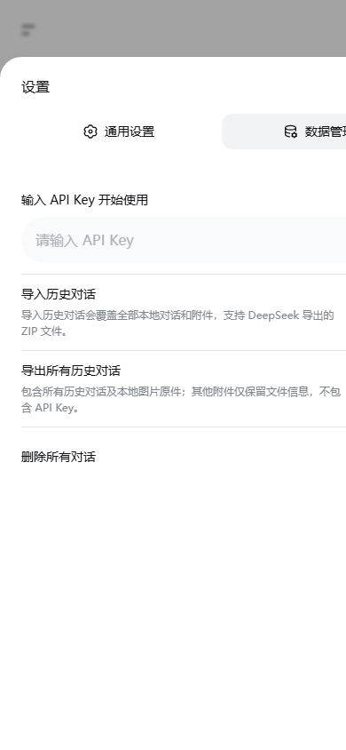

# DS Chat

把 [DeepSeek 开源的 chat-demo](https://github.com/deepseek-ai/chat-demo)（MIT）封装成的 Android 客户端：
WebView 宿主 + 原生桥接，网页功能零改动，离线可用，无需自建后端。

> **非官方项目**：本仓库为社区修改构建，与 DeepSeek 官方无关，未获官方背书。
> 「DeepSeek」名称与 Logo 归其权利人所有。
>
> **上游说明**：上游 `chat-demo` 项目只提供网页版，没有 Android 工程或 APK；DeepSeek 另有自己的
> 官方手机 App（与本开源项目无关）。本项目是社区基于该开源前端做的第三方 Android 封装，不是官方客户端。

[](https://github.com/asdnvh/ds-chat/actions/workflows/build.yml)

## 项目定位

- **只做 Android 封装**：把上游 chat-demo 的官方网页构建产物（`dist`）装进原生 WebView 宿主，
  补齐 Android 系统能力（文件选择、blob 下载、麦克风权限、外链、返回键、状态栏/键盘避让等）。
- **不新增、不修改任何聊天功能**：功能与上游 `chat-demo` 保持一致，上游更新后本项目只做同步打包。
- **非官方客户端**：上游本身只有网页版（无 Android 工程或 APK）；DeepSeek 另有独立官方 App，
  与本项目无关。
- 反馈范围：欢迎提 Android 封装层的问题（安装、权限、WebView 兼容、系统栏/键盘等）；
  网页功能本身的建议或 bug 请提交给[上游项目](https://github.com/deepseek-ai/chat-demo/issues)。

## 特性

- 多会话、流式回复、深度思考、联网搜索、链接阅读、引用来源
- 上传 / 粘贴 / 拖拽附件，语音输入，朗读（TTS）
- Markdown、代码高亮、KaTeX 公式、Mermaid 图
- 简体中文 / English，浅色 / 深色主题，移动端布局
- 聊天历史 ZIP 导入导出，数据全部留在本机
- 原生层补齐：文件选择（多选）、blob 导出保存到 `下载/DSChat`、麦克风权限、外链跳系统浏览器、
  返回键处理、状态栏/导航栏跟随深浅色、键盘与刘海避让、`blob:` 图片全屏预览

## 截图

| 欢迎页（网页 UI 预览） |
| --- |
|  |

> 真机截图欢迎通过 PR 补充（`screenshots/` 目录）。

## 下载安装

- 到 [Releases](../../releases) 下载最新 `DSChat-<版本>.apk`，传到手机安装（需允许「安装未知来源应用」）。
- 要求：Android 8.0（API 26）及以上；建议 Android 10+，且系统 **Android System WebView ≥ 108**。
- App 内不含任何 API Key；首次启动到「设置」填入自己的 DeepSeek API Key
  （在 <https://platform.deepseek.com> 申请），聊天/语音/上传的费用由各自账号承担。

## 构建

环境：JDK 17+（Android Studio 自带 JDK 即可）、Android SDK（platform `android-36`、build-tools `36.0.0`）。

```bash
cd android
./gradlew assembleDebug      # 产物：app/build/outputs/apk/debug/app-debug.apk
./gradlew assembleRelease    # 产物：app/build/outputs/apk/release/app-release.apk
```

Windows 用 `.\gradlew.bat`；也可用 Android Studio 打开 `android/` 目录后 `Build → Build APK(s)`。

- 未配置签名时，release 包使用 debug 签名（仅便于试装，**不要用于正式分发**）；
  正式发布签名配置见 [docs/RELEASE.md](docs/RELEASE.md)。
- 本仓库已内置官方 `dist` 静态产物（`android/app/src/main/assets/`，MIT），可离线构建；
  如需从上游源码重建或升级上游版本，见 [docs/UPSTREAM.md](docs/UPSTREAM.md)。

## 技术架构

```
android/app/src/main/
├── assets/            # 官方 dist 原样（index.html + static/ + LICENSE）+ inject.js + PORT-LICENSE.txt
└── java/com/dschat/android/
    ├── MainActivity   # WebView 宿主：权限、文件选择、外链、弹窗、返回键、系统栏/键盘
    ├── AssetServer    # assets → https://appassets.androidplatform.net 虚拟服务
    ├── DownloadStore  # blob 内容落盘（Android 10+ MediaStore，8/9 兜底）
    └── NativeBridge   # window.DSChatNative 桥接（保存下载、主题色、浮层、日志、Toast）
```

关键点：

- **不用 `file://`**：页面通过虚拟域名 `https://appassets.androidplatform.net/` 从 APK 内读取，
  处于安全上下文，`localStorage` / `IndexedDB` / `getUserMedia` / `AudioContext` 均正常。
- **CORS 已实测**：`api.deepseek.com` 对上述 Origin 的预检请求回显放行，无需自建代理。
- 页面运行时只访问 `https://api.deepseek.com`；外链一律交给系统浏览器。
- 纯 Java + Android Framework，无第三方运行库。

更详细的设计、能力映射与已知限制：[docs/02-安卓移植方案.md](docs/02-安卓移植方案.md)。

## 隐私与安全

- 不收集、不上报任何数据；无遥测、无第三方 SDK、无后台服务。
- API Key 只保存在本机应用私有存储（WebView `localStorage`），不会同步或上传。
- 仅申请 3 个权限：`INTERNET`、`RECORD_AUDIO`（语音输入，运行时申请）、
  `WRITE_EXTERNAL_STORAGE`（仅 Android 9 及以下写导出文件）。
- 聊天记录与附件存在本机 IndexedDB；卸载应用即清除，可用「导出历史」备份。
- `android:allowBackup="false"`，避免 API Key 进入系统云备份。

安全问题请按 [SECURITY.md](SECURITY.md) 私下报告，**不要在 issue 里贴 API Key 或聊天内容**。

## 已知限制

- **历史导入较慢**：导入 ZIP 需要在 WebView 内解压并逐条写入本地数据库（IndexedDB），会话多、图片大时
  可能耗时数十秒甚至更久——**这是正常现象，请耐心等待「已导入 N 个对话」提示，不要重复点击或退出**。
  参考：128 个会话、约 8 MB 的导出包在桌面 Chromium 约 1–2 秒；手机端受 WebView 版本与存储性能影响
  可能明显更慢。导入是事务性的，中途退出不会破坏原有数据。
- **朗读（TTS）**：依赖 WebView 播放 24 kHz PCM，个别厂商 WebView 音频策略不同。
- **语音输入**：页面使用 `ScriptProcessorNode`（已废弃但 WebView 仍支持），未来可能需要上游或原生改造。
- **历史导出**：blob 经 JS 桥接以 base64 写入下载目录，聊天记录特别大时占用内存较多。
- **外部链接**：一律在系统浏览器打开，不在 App 内打开。
- 未实现：相机直拍上传、系统分享菜单、应用内更新提示。

## 上游与许可

- 上游项目：<https://github.com/deepseek-ai/chat-demo>（v0.1.1，MIT，Copyright (c) 2026 DeepSeek）。
- 本仓库的 Android 移植代码与文档：Copyright (c) 2026 DS Chat project contributors，MIT。
- 完整的许可与上游归属：[LICENSE](LICENSE)；上游许可证原文保留在
  `android/app/src/main/assets/LICENSE`。
- 第三方依赖声明（209 个生产依赖）：[docs/THIRD-PARTY-NOTICES.md](docs/THIRD-PARTY-NOTICES.md)。

## 贡献

欢迎 issue / PR，请先看 [CONTRIBUTING.md](CONTRIBUTING.md)。提交即表示同意以 MIT 协议发布你的贡献。

## 变更日志

见 [CHANGELOG.md](CHANGELOG.md)。
